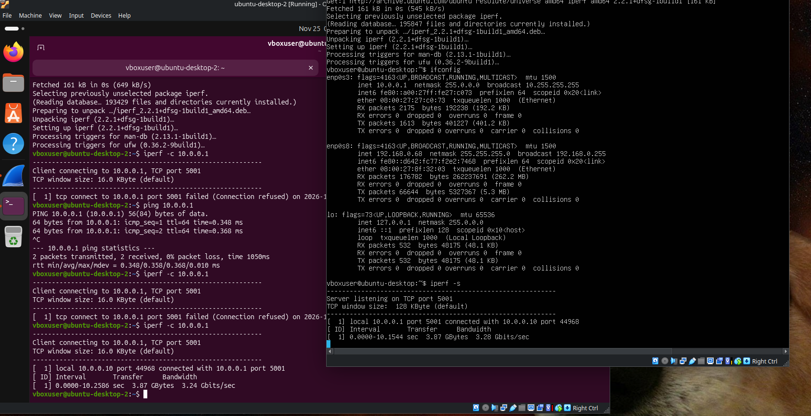
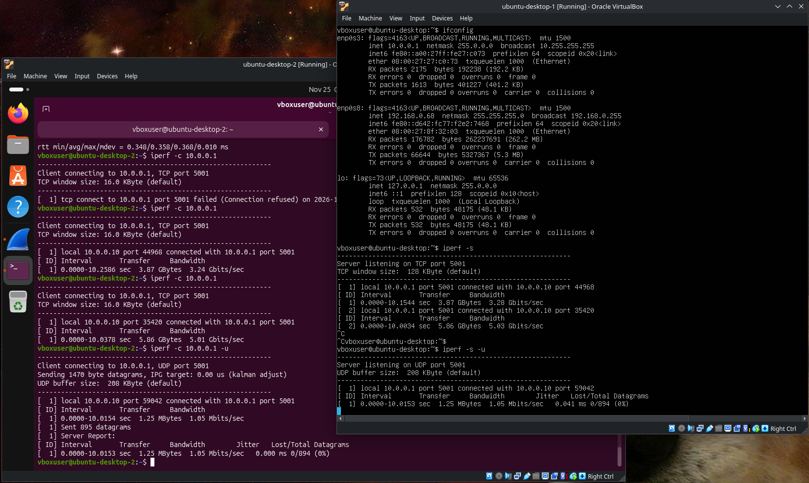
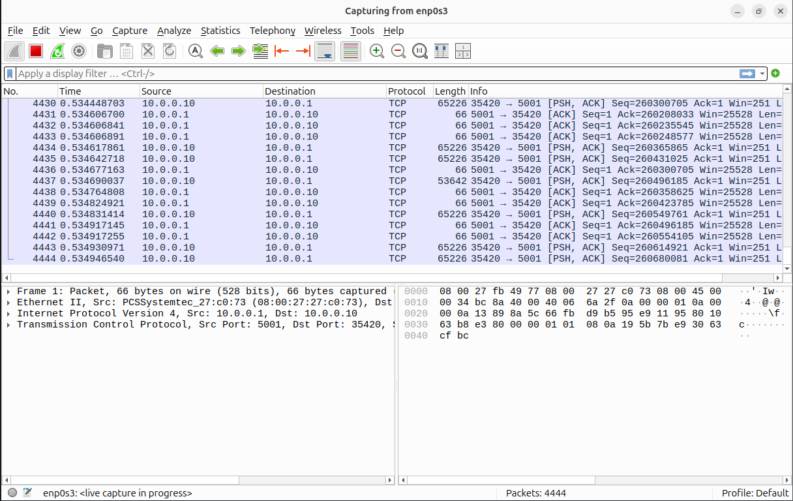
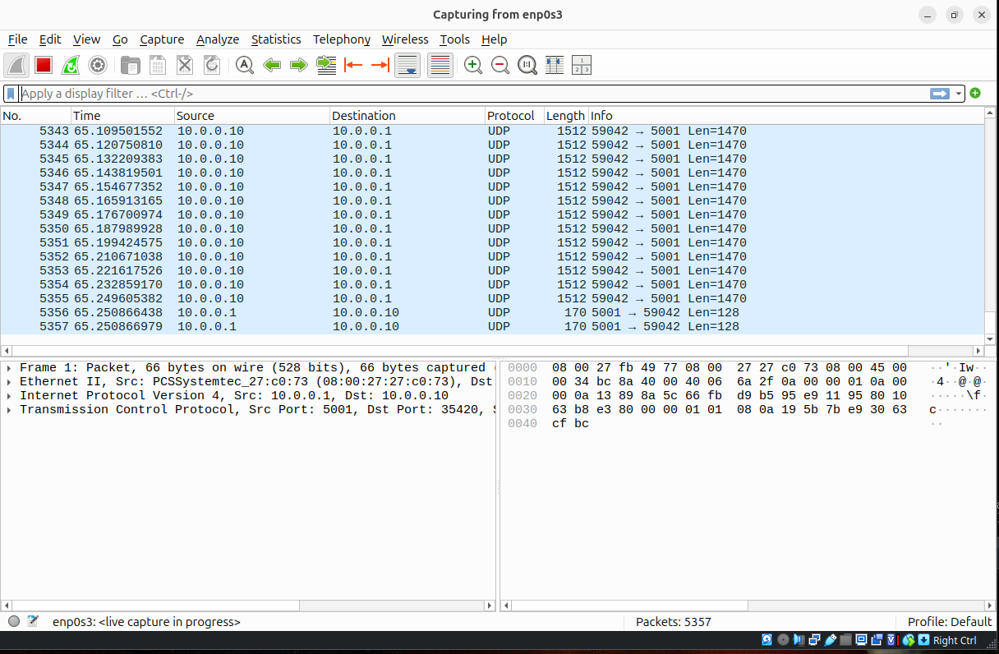

# Test cases

**Test 1.1** Closed TCP port, peer answers ICMP

**Test objective:** Verify that a refused iperf connection to TCP port 5001 can be separated from an unreachable host: 10.0.0.1 still answers ICMP.

**Preconditions:** Client virtual machine ubuntu-desktop-2, user vboxuser, address 10.0.0.10. iperf 2.2.1+dfsg-1build1 is installed there. Server virtual machine ubuntu-desktop (VirtualBox name ubuntu-desktop-1), user vboxuser. Inside interface enp0s3 is up at 10.0.0.1/8, MAC 08:00:27:27:c0:73. Outside interface enp0s8 is up at 192.168.0.68/24, MAC 08:00:27:8f:32:03. The iperf server is not listening yet.

**Requirements:** FU-1. While nothing listens on TCP port 5001, an iperf client must be refused, and ICMP to the same address must succeed.

**Priority:** High

**Severity:** Major

**Tester:** Vladyslav Sukhomlin

**Result:** Passed.

**Attachments:** tcp-iperf-refused-and-first-run.png.

| Steps | Expected result |
| --- | --- |
| Start an iperf TCP client toward 10.0.0.1. | The client reports tcp connect to 10.0.0.1 port 5001 failed (Connection refused). |
| Ping 10.0.0.1 from the same client. | Echo replies come back. Two packets are sent and two are received, with no loss. |
| Repeat the iperf TCP client before the server is started. | The connection is refused again. |

## What the messages mean

Connection refused on TCP port 5001 means the host answered and no process is listening on that port. The client prints this twice, both times before `iperf -s` is running on ubuntu-desktop.

The ping in the same session reaches 10.0.0.1. Two packets are transmitted, two are received, loss is 0%, and the round-trip time is 0.348/0.358/0.368/0.010 ms (min/avg/max/mdev). The address answers ICMP, so the refused TCP connection is a closed port.

## Attachments

Run evidence, 25 Nov 2026.

### tcp-iperf-refused-and-first-run.png

Client ubuntu-desktop-2 installs iperf 2.2.1+dfsg-1build1 and runs `iperf -c 10.0.0.1`. The first attempt is refused on TCP port 5001. `ping 10.0.0.1` then returns two replies, 0% loss, rtt min/avg/max/mdev = 0.348/0.358/0.368/0.010 ms. A second `iperf -c 10.0.0.1` is refused as well. On the server, ifconfig shows enp0s3 at 10.0.0.1/8 and enp0s8 at 192.168.0.68/24. After `iperf -s` starts, the next client attempt connects: local 10.0.0.10 port 44968 to 10.0.0.1 port 5001, 0.0000–10.2586 sec, 3.87 GBytes, 3.24 Gbits/sec.

**Test 1.2** TCP iperf transfer, client and server counts

**Test objective:** Verify that an iperf TCP server on 10.0.0.1 accepts a client at 10.0.0.10 and that both sides report the same transferred volume.

**Preconditions:** Test 1.1 is done: 10.0.0.1 answers ICMP. iperf 2.2.1 is installed on the client and on the server. The tester can run `iperf -s` on ubuntu-desktop and `iperf -c 10.0.0.1` on ubuntu-desktop-2. Wireshark on the server can capture enp0s3.

**Requirements:** FU-2. The TCP server must accept the client on port 5001. Client and server must report the same byte count for each run. The capture on enp0s3 must show data toward port 5001 and acknowledgements back to the client.

**Priority:** High

**Severity:** Critical

**Tester:** Vladyslav Sukhomlin

**Result:** Passed.

**Attachments:** tcp-iperf-refused-and-first-run.png; udp-iperf-and-second-tcp-run.png; tcp-iperf-capture-enp0s3.png.

| Steps | Expected result |
| --- | --- |
| Start the iperf TCP server. | The server listens on TCP port 5001. The TCP window size is 128 KByte. |
| Run the client once. | 10.0.0.10 connects to 10.0.0.1 port 5001. Both sides report 3.87 GBytes. |
| Run the client a second time. | A new client port connects to port 5001. Both sides report 5.86 GBytes. |
| Review the capture on the inside interface for the second run. | Wireshark on enp0s3 shows TCP data from 10.0.0.10 port 35420 to 10.0.0.1 port 5001, and acknowledgements in the opposite direction. |

## Attachments

Run evidence, 25 Nov 2026. The first run is on the client screen from Test 1.1 and on the server screen below. The intervals differ by a fraction of a second, so the reported bit rate differs while the byte count stays the same.

### udp-iperf-and-second-tcp-run.png

Server ubuntu-desktop, `iperf -s`. First connection: local 10.0.0.1 port 5001 with 10.0.0.10 port 44968, 0.0000–10.1544 sec, 3.87 GBytes, 3.28 Gbits/sec. Second connection: client port 35420, 0.0000–10.0034 sec, 5.86 GBytes, 5.03 Gbits/sec. On the client the same two runs are 0.0000–10.2586 sec, 3.87 GBytes, 3.24 Gbits/sec (port 44968) and 0.0000–10.0378 sec, 5.86 GBytes, 5.01 Gbits/sec (port 35420). The lower part of this screen is the UDP run used in Test 1.3.

### tcp-iperf-capture-enp0s3.png

Wireshark is capturing from enp0s3, 4444 packets. The visible rows are the second TCP run: data from 10.0.0.10 port 35420 to 10.0.0.1 port 5001, lengths 65226 and 53642 bytes, and 66-byte acknowledgements from 10.0.0.1 port 5001 back to port 35420. The detail pane is on frame 1, TCP source port 5001, destination port 35420, IP 10.0.0.1 to 10.0.0.10, Ethernet source 08:00:27:27:c0:73. Those data lengths are above the 1500-byte MTU of enp0s3; the capture is on the host that receives the data.

**Test 1.3** UDP iperf transfer, loss and datagram size

**Test objective:** Verify that an iperf UDP server on port 5001 receives a client stream of 1470-byte datagrams and reports the loss.

**Preconditions:** The TCP runs in Test 1.2 are finished. iperf is installed on both virtual machines. The tester can run `iperf -s -u` on ubuntu-desktop and `iperf -c 10.0.0.1 -u` on ubuntu-desktop-2. Wireshark can keep capturing enp0s3.

**Requirements:** FU-3. The UDP server must accept the client on port 5001. The report must include bandwidth, jitter and lost datagrams. The capture must show 1470-byte UDP payloads from the client to port 5001.

**Priority:** High

**Severity:** Critical

**Tester:** Vladyslav Sukhomlin

**Result:** Passed.

**Attachments:** udp-iperf-and-second-tcp-run.png; udp-iperf-capture-enp0s3.png.

| Steps | Expected result |
| --- | --- |
| Start the iperf UDP server. | The server listens on UDP port 5001. The UDP buffer size is 208 KByte. |
| Run the UDP client toward 10.0.0.1. | The client sends 1470-byte datagrams. Both sides report 1.25 MBytes and 1.05 Mbits/sec. The server counts 0 lost datagrams out of 894. |
| Review the capture on enp0s3. | UDP packets go from 10.0.0.10 port 59042 to 10.0.0.1 port 5001 with a 1470-byte payload. A short packet returns from port 5001 to the client. |

## What the results mean

The UDP rate is 1.05 Mbits/sec. iperf 2 uses a target near 1 Mbit/s for UDP when the client is started without a bandwidth option. The TCP runs on this same path moved 3.87 GBytes and 5.86 GBytes in about 10 seconds, so this UDP figure is the offered rate of the test.

The client says it sent 895 datagrams. The server report counts 894 datagrams and 0 lost (0/894). The client prints the server report with jitter 0.000 ms. The server console prints jitter 0.041 ms for the same interval 0.0000–10.0153 sec, the same 1.25 MBytes, and the same 0/894 loss.

## Attachments

Run evidence, 25 Nov 2026.

### udp-iperf-and-second-tcp-run.png

After the two TCP runs, the server is restarted with `iperf -s -u` and listens on UDP port 5001, buffer 208 KByte. The client runs `iperf -c 10.0.0.1 -u`: 1470-byte datagrams, local 10.0.0.10 port 59042 to 10.0.0.1 port 5001, 0.0000–10.0154 sec, 1.25 MBytes, 1.05 Mbits/sec, 895 datagrams sent. The client’s server report is 0.0000–10.0153 sec, 1.25 MBytes, 1.05 Mbits/sec, jitter 0.000 ms, 0/894 (0%). The server console shows the same interval, volume and loss, with jitter 0.041 ms.

### udp-iperf-capture-enp0s3.png

The same capture on enp0s3, later in the list (5357 packets). UDP packets go from 10.0.0.10 port 59042 to 10.0.0.1 port 5001, frame length 1512, UDP payload length 1470. Two short packets return from 10.0.0.1 port 5001 to port 59042, frame length 170, UDP length 128. The detail pane is still on the earlier TCP frame from port 5001 to port 35420.
